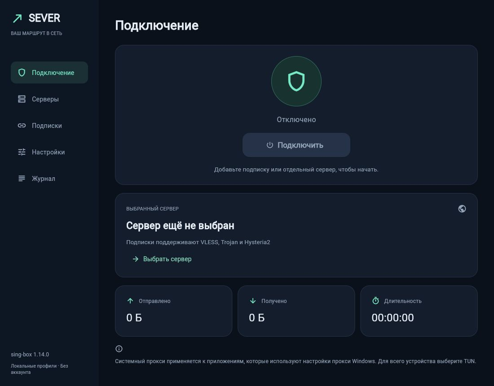

# Lunaris client

**0.7.1** — обновлены ядра Mihomo до 1.19.34, sing-box и Android libbox до 1.14.4, Xray до 26.11.9.

**0.7.0** — свои домены для прямого подключения и проверка обновлений:

- В настройках маршрутизации можно указать домены, которые открываются
  напрямую, включая их поддомены. Список сохраняется автоматически
  и применяется в sing-box и Mihomo на Windows и Android.
- Приложение проверяет стабильные выпуски на GitHub при запуске и позволяет
  открыть загрузку ZIP или APK в системном браузере. Ручная проверка доступна
  в настройках.

**0.6.5** — анимации вкладок, сортировка по пингу и трей:

- Новое название приложения: **Lunaris client**, включая окно Windows,
  имя EXE, Android launcher и уведомление VPN.
- Переходы вкладок с затуханием и сдвигом; быстрый повторный выбор отменяет
  предыдущий переход. Системное уменьшение движения отключает эффекты.
- «Автосортировка по пингу» включена по умолчанию, сохраняется в хранилище
  и доступна в настройках и у списков на главной странице и в «Серверах».
  Меньший пинг выше; непроверенные и недоступные серверы в конце.
  Отключение возвращает исходный порядок без изменения выбора сервера.
- Windows: закруглённая иконка с прозрачными углами, кнопка «Свернуть в трей»,
  отдельные настройки сворачивания и закрытия в трей (включены по умолчанию).
  Левый клик по трею открывает окно; правый — меню с подключением,
  отключением, проверкой пинга, обновлением подписок, настройками и выходом.
  «Выход» останавливает VPN и восстанавливает системный прокси.

**0.6.4** — подписки и список серверов на экране подключения:

- В главном списке показаны только серверы подписки последнего выбранного
  сервера; для ручного сервера — только добавленные вручную. Выбор сохраняется
  после перезапуска. В разделе «Серверы» остаются все источники.
- Рядом со списком на главном экране доступен селектор TCP/UDP, ICMP
  и PROXY GET (Windows). Кнопка «Проверить» проверяет только показанную группу;
  выбранный метод общий с разделом «Серверы».
- Описание от создателя подписки показано на главном экране. В разделе
  «Подписки» есть дата и время окончания, на главном — предупреждения за
  три дня и сообщения об истёкших подписках.

**0.6.3** — обновлённый интерфейс подключения, DNS и анимированные обои:

- Анимированные обои как в dayplanner: волны (включены по умолчанию),
  северное сияние, пузыри, звёзды и переливы. В «Внешний вид» можно выбрать
  вариант, настроить яркость или отключить фон. Выбор сохраняется на устройстве;
  цвета следуют акценту и теме. В скрытом окне анимация останавливается,
  а при системном уменьшении движения отображается статичный фон.
- Подключение и отключение — нажатием на круг со щитом. Рядом со способом
  подключения расположен селектор проверки задержки выбранного сервера;
  его значение общее с настройками. На Android доступен селектор задержки.
- Проверка списка на экране «Подключение» использует метод, выбранный
  в разделе «Серверы»: TCP/UDP, ICMP или PROXY GET (последний — на Windows).
- В настройках DNS доступны Cloudflare (по умолчанию), Google, Яндекс
  и «Свой вариант». Предустановки автоматически задают IP, Bootstrap DNS
  и TLS-имя; в своём варианте эти поля редактируются вручную. Протокол
  HTTPS/TLS/UDP выбирается отдельно. Существующие ручные адреса сохраняются.

**0.6.2** — автосохранение настроек, селектор способа подключения на главном
экране Windows и жёлтые кнопки во время подключения во всех темах.
Настройки сохраняются отдельно, ошибки показаны рядом с полями; запуск
подключения дожидается завершения сохранения.

Начиная с **0.6.1 весь прикладной бэкэнд перенесён на Rust.** Общий модуль
`app/backend` напрямую подключён к Tauri на Windows и Android: импорт URI,
подписки и их обновление, настройки, защищённое хранилище, конфигурации
sing-box/Xray/Mihomo, подключение, статистика, задержка и очищенный журнал.
В EXE/APK нет Python, PyInstaller, Chaquopy, Flet или Flutter.
Android использует Kotlin только для системной VPN-службы, разрешений,
Keystore и Binder; сами VPN-ядра сохранены без изменения.

Интерфейс Tauri 2: подключение, серверы с поиском и фильтром, подписки,
настройки и журнал. Темы Material, AMOLED, Liquid glass и Simple;
системная/светлая/тёмная схема и свой акцентный цвет.
Настройки сохраняются автоматически: переключатели и списки — сразу,
текстовые поля — через полсекунды после ввода или при выходе из поля.
Ошибки отображаются рядом с полем и не мешают сохранению остальных параметров.
Подписки загружаются в фоне, их содержимое разбирается в рабочем потоке.
Во время обновления доступны подключение, проверка пинга и выбор сервера.
На главном экране Windows способ подключения выбирается селектором:
«Системный прокси» или «TUN · весь трафик устройства». Выбор общий с настройками
и применяется при следующем подключении; для TUN нужны права администратора.
Поддерживаются VLESS/Reality, Trojan, Hysteria2, XHTTP и gRPC,
TCP/UDP, ICMP, PROXY GET и импорт `lunaris://`.

Сохранены Android applicationId `dev.sever.sever_client`, Keystore alias
`sever.storage.v2`, формат `SEVER2` и Windows-хранилище
`%LOCALAPPDATA%/SeverVPN`. Совместимость Windows DPAPI проверена в обе стороны
с прежними Python-данными. APK использует прежнюю локальную debug-подпись.

## Обновление приложения

При запуске приложение в фоне проверяет последний стабильный релиз
[GodPens656/Lunaris-VPN](https://github.com/GodPens656/Lunaris-VPN/releases).
Если его версия выше установленной и файл для текущей платформы уже загружен,
появляется диалог **«Доступно обновление»** с кнопками **«Позже»** и **«Скачать»**.
«Скачать» открывает прямую загрузку через системный браузер: ZIP с полной
сборкой Windows x64 или APK для Android ARM64. После загрузки распакуйте весь
ZIP-архив либо откройте APK для установки обновления.

«Позже» скрывает предложение этой версии до следующего запуска. Проверить
обновление и снова открыть предложение можно в **«Настройки → Обновление
приложения → Проверить обновление»**. При возвращении в приложение фоновая
проверка повторяется не чаще раза в час. Отсутствие интернета, ограничение
GitHub API и отсутствие релизов не мешают запуску и работе VPN.

Для публикации обновления создайте обычный GitHub Release с тегом `vX.Y.Z`
(также поддерживается `X.Y.Z`) и приложите файлы:

- `LunarisClient-X.Y.Z-windows-x64.zip` — сборка Windows вместе с runtime;
- `LunarisClient-X.Y.Z-arm64.apk` — сборка Android ARM64.

Номер `X.Y.Z` должен совпадать с версией собранного приложения. Черновики,
предварительные версии, исходники и файлы другой платформы не предлагаются.
Проверка использует публичный
[GitHub Releases API](https://docs.github.com/en/rest/releases/releases#get-the-latest-release)
без токена. Если файлы ещё не опубликованы, предложение появится после их
добавления и следующей проверки.

## Готовые сборки

Готовые файлы версии 0.7.1:

- `dist/LunarisClient-0.7.1-windows-x64.zip` — распаковать **всю** папку и запустить `LunarisClient.exe`.
- `dist/LunarisClient-0.7.1-arm64.apk` — Android ARM64, versionCode **28**.
- `dist/LunarisClient-0.7.1-source.zip` — исходники с Cargo.lock и package-lock.json.
- `dist/SHA256SUMS-0.7.1.txt` — контрольные суммы.

Windows требует Microsoft Edge WebView2 Runtime. TUN требует прав
администратора. По умолчанию закрытие окна Windows оставляет приложение и VPN в трее.
Команда «Выход» в меню трея останавливает VPN и восстанавливает системный
прокси. Если отключить «Оставлять в трее при закрытии окна», закрытие окна
также завершает приложение. Отдельный Rust-процесс восстановления работает и после
аварийного завершения приложения. Закрытие Android-интерфейса сохраняет
foreground VPN-службу.

На экране «Подключение» показано описание подписки
выбранного сервера, заданное её создателем. Оно загружается из HTTP-заголовка
`announce` или строки `#announce:` в теле подписки; поддерживаются обычный
UTF-8 и `base64:` ([формат метаданных](https://www.happ.su/main/dev-docs/app-management)).
Для существующей подписки описание появится после её обновления.
В разделе «Подписки» срок действия показан отдельно, с датой и временем
в часовом поясе устройства. Если провайдер не передал срок или указал
`expire=0`, отображается «Срок действия не указан».
На главном экране показаны предупреждения для всех подписок, которым осталось
не более 72 часов, и сообщения об истёкших подписках. Число оставшихся дней
округляется вверх; состояние пересчитывается при открытом приложении.

## Сборка 0.7.1

Нужны Rust stable MSVC, Node.js 22 LTS и Visual Studio C++ Build Tools.
Для Android также нужны Go 1.27+, Git, JDK 17, SDK 36, NDK 28.2 и принятые лицензии SDK.
Python 3.13 используется только инструментами подготовки и упаковки.

```powershell
python -m venv .venv
.venv/Scripts/python.exe -m pip install -e ".[dev]"
cd app
npm ci
cd ..
./scripts/build.ps1 -Target all
```

`-Target windows` или `-Target apk` собирает одну платформу. Инструменты
проверяют SHA-256 ядер и переносят сборку в отдельный каталог с ASCII-путём.
Для запуска: `scripts/run.ps1`; при отсутствии EXE запускается Tauri dev.
`LUNARIS_DATA_DIR` задаёт отдельное тестовое хранилище и отключает регистрацию
URL-протокола; само по себе это не отключает изменение системного прокси.

## Проверки Rust-бэкэнда

```powershell
cargo test --locked --manifest-path app/backend/Cargo.toml
cargo clippy --locked --manifest-path app/backend/Cargo.toml --all-targets -- -D warnings
python scripts/fetch_core.py windows
python scripts/fetch_core.py windows --core flclash
cargo test --locked --manifest-path app/backend/Cargo.toml --test backend bundled_cores_start_report_traffic_and_release_ports -- --ignored
cargo build --locked --manifest-path app/backend/Cargo.toml --bin lunaris-backend-cli
.venv/Scripts/python.exe -m pip install -e ".[dev,legacy-tests]"
.venv/Scripts/python.exe scripts/check_rust_parity.py app/backend/target/debug/lunaris-backend-cli.exe --full -q
$env:LUNARIS_TEST_RUST_CLI = (Resolve-Path app/backend/target/debug/lunaris-backend-cli.exe).Path
.venv/Scripts/python.exe -m pytest tests/test_rust_runtime.py -q
```

`src/sever` — прежняя Python-реализация, сохранённая как эталон для
регрессионных тестов; в runtime она не включается. Интеграционные Rust-тесты
проверяют локальные зашифрованные туннели через sing-box, Mihomo и Xray,
используют обязательный `--probe` и проверяют неизменность системного прокси.
Результаты и ограничения проверки: [docs/VALIDATION.md](docs/VALIDATION.md).

## История до перехода на Tauri


Клиент переименован из Sever VPN в Lunaris VPN. Новое имя используется в
интерфейсе, системном названии приложения и уведомлении VPN. Идентификатор
приложения и защищённое хранилище сохранены для совместимости при обновлении.
Начиная с 0.5.0 архивы выпуска называются `LunarisVPN-<версия>-…`;
предыдущие сборки перечислены ниже под прежним именем Sever VPN.

Иконка Windows: `src/assets/icon.png`. Android использует отдельный файл
`src/assets/icon_android.png`: фон заполняет квадрат, а луна и звезда уменьшены
и размещены внутри безопасной области адаптивной иконки, чтобы системная маска
не обрезала логотип. После замены PNG нужно пересобрать EXE/APK.
Оба файла иконок включаются в Git и архив исходников.
При запуске Windows из Python ICO создаётся из PNG автоматически и назначается
окну и панели задач. В Windows-сборку ICO включается заранее; на установленном
клиенте генератор изображений не требуется.

**0.5.1** — Windows x64, сборка 20. В «Настройки → Подключение»
добавлен переключатель «Проверять HTTPS при подключении». По умолчанию
проверка включена; после отключения запуск VPN не зависит от доступности
сайта проверки. Настройка сохраняется автоматически.
Windows portable: `dist/LunarisVPN-0.5.1-windows-x64.zip`;
полная папка: `dist/windows-0.5.1`.
Исходники: `dist/LunarisVPN-0.5.1-source.zip`;
контрольные суммы: `dist/SHA256SUMS-0.5.1.txt`.

**0.5.0** — выпуск для Windows x64 и Android ARM64, сборка 18.
Из боковой панели убраны подписи «ВАШ МАРШРУТ В СЕТЬ» и
«Локальные профили · Без аккаунта». Включены текущие доработки диалогов
и импорт подписки через `lunaris://`.
Windows portable: `dist/LunarisVPN-0.5.0-windows-x64.zip`;
Android: `dist/LunarisVPN-0.5.0-arm64.apk` (versionCode 18).

Исправленная Android-иконка: `dist/LunarisVPN-0.5.0-android-icon-arm64.apk`
(versionCode 19). Логотип больше не обрезается маской значка; APK устанавливается
как обновление версии 0.5.0.
Исходники: `dist/LunarisVPN-0.5.0-source.zip`;
контрольные суммы: `dist/SHA256SUMS-0.5.0.txt`.

**0.4.0** — общий выпуск для Windows x64 и Android ARM64 из текущих исходников.
Обновлённая сборка 17 автоматически следует светлой или тёмной теме устройства.
Список серверов на главной сворачивается через ExpansionTile. Кнопка со
спидометром в его заголовке проверяет TCP/UDP-задержку серверов этого списка;
результаты показаны рядом с серверами, повторное нажатие останавливает проверку.
Включает изменения 0.3.3 и диалог добавления подписки при первом запуске:
название подписки необязательно и автоматически берётся из `Profile-Title`
или домена ссылки. Ручное название сохраняется при обновлении подписки.
Windows portable: `dist/SeverVPN-0.4.0-windows-x64.zip`;
Android: `dist/SeverVPN-0.4.0-arm64.apk`, versionCode 17.
Исходники: `dist/SeverVPN-0.4.0-source.zip`;
контрольные суммы: `dist/SHA256SUMS-0.4.0.txt`.
Результаты проверок — в [docs/VALIDATION.md](docs/VALIDATION.md).

**0.3.3** дорабатывает переключение между VPN на Android. При нажатии
«Подключить» Sever каждый раз запрашивает право стать текущим VPN через
`VpnService.prepare()`: Android автоматически отключает прежний VPN.
Если требуется системное подтверждение, его нужно принять; отдельное ручное
отключение другого клиента обычно не требуется. При отказе Android приложение
поясняет, где проверить режим «Постоянная VPN» другого клиента.
После системного подтверждения право проверяется повторно, ошибки запроса
не блокируют повторную попытку, отменённый запрос не запускает VPN позднее.
При переходе из Sever в другой VPN текущий сеанс штатно останавливается,
включая запуск ядер и проверку соединения.
APK: `dist/SeverVPN-0.3.3-arm64.apk`, versionCode 15, прежняя тестовая
подпись для установки поверх 0.3.2. Windows portable остаётся версии 0.3.1.
Переключение с реальным сторонним VPN на телефоне ещё требует проверки.

**0.3.2** усиливает поддержку уведомления Android VPN при длительной работе:
проверка выполняется отдельно от главного потока и опроса ядра, уведомление
повторно публикуется каждые 30 секунд и сразу при включении/разблокировке экрана.
Время сна учитывается через elapsedRealtime; временные ошибки проверки и
публикации не прекращают последующие попытки. После отключения или ошибки
VPN восстановление отменяется. APK: `dist/SeverVPN-0.3.2-arm64.apk`,
versionCode 14, установка поверх 0.3.1 с прежней тестовой подписью.
Работа после долгого простоя на физическом телефоне ещё требует проверки.
Windows portable остаётся версии 0.3.1.

**0.3.1** исправляет отказ импорта «ECH через мост Xray пока не поддерживается»:
ECHConfigList теперь передаётся в Xray, включая VLESS/Trojan gRPC с mode=multi
и authority, а также XHTTP и VLESS Encryption. Проверка TLS сохраняется;
при отказе ECH клиент не переключается на обычный TLS.
На Windows случайный порт Xray/SOCKS и массовой проверки выбирается с проверкой
доступности TCP и UDP, включая зарезервированные Windows UDP-диапазоны.
Сообщения импорта различают неподдерживаемый протокол и неверный формат ссылки,
не показывая адреса и учётные данные.

Исправленные сборки: `dist/SeverVPN-0.3.1-windows-x64.zip` и
`dist/SeverVPN-0.3.1-arm64.apk` (versionCode 13, прежняя тестовая подпись).
Исходники: `dist/SeverVPN-0.3.1-source.zip`;
контрольные суммы: `dist/SHA256SUMS-0.3.1.txt`.
При обновлении приложения повторно обновите подписку, чтобы импортировать
ранее отклонённый ECH-профиль. Неизвестные протоколы не становятся VLESS из-за
использования gRPC; их поддержка требует отдельного адаптера.

Версия **0.3.0** расширяет поддержку gRPC для VLESS и Trojan в Windows и Android:
импортируются `type=grpc`, `serviceName`, `mode=gun` / `mode=multi` и `authority`.
Обычный gRPC работает через выбранное ядро. Для `mode=multi` или непустого
`authority` соединение автоматически запускается через sing-box / Xray;
сохранённый выбор ядра не меняется, фактическое ядро отображается в интерфейсе
и журнале. `authority` задаёт HTTP/2 Host независимо от TLS SNI.
Несовместимые HTTP/WS-параметры отклоняются; явно заданный ALPN должен включать `h2`.
Xray 26.3.27 больше не принимает `allowInsecure=1`, поэтому такие Xray-профили
отклоняются при импорте с пояснением. Используйте проверяемый TLS-сертификат или Reality.

Сборки 0.3.0: Windows x64 portable — `dist/SeverVPN-0.3.0-windows-x64.zip`,
Android ARM64 — `dist/SeverVPN-0.3.0-arm64.apk` (versionCode 12),
исходники — `dist/SeverVPN-0.3.0-source.zip`.
Контрольные суммы — `dist/SHA256SUMS-0.3.0.txt`.
APK использует прежний тестовый ключ для обновления 0.2.8.
Проверки и ограничения: [docs/VALIDATION.md](docs/VALIDATION.md).

Пример импорта gRPC (синтетический адрес):

```text
vless://11111111-1111-4111-8111-111111111111@example.com:443?encryption=none&security=tls&type=grpc&serviceName=SeverVPN&mode=gun&sni=example.com#Example%20gRPC
```

Для MultiMode замените `mode=gun` на `mode=multi`; при необходимости добавьте
`&authority=cdn.example.com`. Параметры должны совпадать с настройками сервера.
Схема Xray: [gRPC](https://xtls.github.io/en/config/transports/grpc.html).

Клиент для Windows и Android: общий интерфейс Flet/Python, подписки и локальная конфигурация, выбор sing-box / Xray или Clash (Mihomo). Аккаунты, платежи и серверный бэкенд отсутствуют.

Если сохранённых подписок нет, при запуске открывается диалог добавления с кнопкой
«Позже». Достаточно вставить ссылку: название необязательно и берётся из
`Profile-Title` ответа подписки (обычный текст или Base64 UTF-8;
[описание формата](https://github.com/hiddify/hiddify-app/wiki/URL-Scheme)).
Если провайдер не передаёт название, используется домен ссылки без пути и токенов.
Автоматическое название обновляется вместе с подпиской; введённое вручную сохраняется.

### Импорт подписки по ссылке

Клиент поддерживает открытие подписки из браузера или другого приложения:

```text
lunaris://import://https://example.com/subscription/token
```

После открытия появляется подтверждение «Импорт подписки». Только после нажатия
«Импортировать» подписка сохраняется и загружаются серверы; «Отмена» ничего не
добавляет. Название берётся из подписки или домена. Повторное открытие уже
сохранённого URL не создаёт копию. Параметры и экранированные токены URL сохраняются.

Поддерживаются Windows и Android, включая передачу ссылки уже работающему клиенту.
На Windows нужно один раз запустить обновлённый клиент: он регистрирует `lunaris://`
для текущего пользователя без прав администратора. После переноса portable-папки
запустите клиент из нового расположения, чтобы обновить регистрацию.
На Android обработчик входит в APK. Для использования этой возможности требуется
пересобрать и установить клиент из обновлённых исходников.

Windows передаёт запрос работающему клиенту через временную очередь, защищённую
DPAPI текущего пользователя; обработанные и просроченные запросы удаляются.
Полный адрес в подтверждении скрыт и раскрывается кнопкой в поле адреса.

Это инженерная версия. На Windows проверены локальные зашифрованные туннели VLESS/TLS, VLESS/Reality TCP и XHTTP, Trojan и Hysteria2 с ECH. Android содержит нативный адаптер и готовую библиотеку; **работа VPN на Android-устройстве ещё не подтверждена**. Раздел «Проверки и ограничения» отделяет результаты от неподтверждённых сценариев.

Версия 0.2.8 восстанавливает уведомление VPN после смахивания на Android 14+ и других устройствах, позволяющих скрыть постоянное уведомление. Пока VPN работает или подключается, уведомление возвращается с текущим статусом и именем сервера. Резервная проверка выполняется каждые две секунды; после отключения или ошибки восстановление прекращается. APK arm64 — `dist/SeverVPN-0.2.8-arm64.apk`, versionCode 11; возможна установка поверх 0.2.7. Подробный протокол — [docs/VALIDATION.md](docs/VALIDATION.md).

Версия 0.2.7 добавляет на главную список серверов из подписки последнего выбранного сервера. Кнопка измерения задержки и один результат находятся рядом с кнопкой подключения. Метод выбирается в «Настройки → Подключение → Метод измерения задержки»: по умолчанию **via PROXY GET**, также доступны TCP/UDP и ICMP.

Версия 0.2.6 исправляет сброс выбранного сервера при обновлении подписки после долгого простоя или перезапуска. При изменении параметров подключения сервер сопоставляется с прежним по протоколу, имени и адресу внутри той же подписки; выбор сохраняется в защищённом хранилище. Неоднозначные совпадения не выбираются по позиции списка.

Версия 0.2.5 исправляет ошибку запуска Mihomo на Android `yaml: found unknown escape character`: экранирование слешей в Android JSON преобразуется в совместимое с YAML без изменения значений строк. Причина воспроизведена настоящим Mihomo; исправленная конфигурация проходит проверку и запускает локальный SOCKS. Сохранены диагностика ядра, проверка его упаковки, исправления отключения, TUN/DNS и мобильные отступы. Работа полного VPN на телефоне после обновления ещё требует проверки. Windows portable остаётся версии 0.2.0 в `dist/windows-0.2.0` и `dist/SeverVPN-0.2.0-windows-x64.zip`; AAB в `dist` относится к предыдущей версии.



## Быстрый запуск Windows

Требуются Windows 10/11 x64 и Python 3.13 x64. Go SDK не нужен.

```powershell
py -3.13 -m venv .venv
.venv\Scripts\python.exe -m pip install -e ".[dev]"
.venv\Scripts\python.exe scripts\fetch_core.py windows
.venv\Scripts\python.exe scripts\fetch_core.py windows --core flclash
powershell -NoProfile -ExecutionPolicy Bypass -File scripts\run.ps1
```

Добавьте HTTP/HTTPS-подписку на экране «Подписки». После загрузки выберите сервер на экране «Серверы» и подключитесь. Отдельную ссылку или проверяемый локальный JSON можно вставить через «Импорт». Пример использует синтетический адрес и не предназначен для подключения:

```text
trojan://synthetic-password@example.com:443?sni=example.com#Example
```

При включённом VPN выбор другого сервера автоматически отменяет незавершённое подключение или отключает текущее, дожидается очистки и подключается к выбранному серверу. Повторный выбор текущего сервера не перезапускает соединение. При выключенном VPN выбор сервера сохраняется без подключения.

На экране «Подключение» показан список серверов из подписки последнего выбранного сервера. Поиск и фильтр раздела «Серверы» на него не влияют. Для ручного профиля показаны ручные серверы. Нажатие на строку сохраняет выбор и при работающем VPN переключает соединение. Раскрытый список занимает полную высоту содержимого и прокручивается вместе со страницей.

Кнопка **«Измерить задержку»** и один результат находятся в карточке подключения. Запускается только метод из **«Настройки → Подключение → Метод измерения задержки»**; по умолчанию — **via PROXY GET**. Выбор сохраняется автоматически и доступен для изменения при работающем VPN. При смене метода текущий замер отменяется, старый результат сбрасывается. Доступные методы:

- **TCP/UDP** — протокол выбирается автоматически: для Hysteria 2 измеряется время ответа QUIC через UDP (с учётом Salamander), для остальных — время открытия TCP-соединения. Замер включает разрешение DNS. Рядом с результатом указан фактический протокол: TCP или UDP. Успех означает ответ транспорта; учётные данные VPN эта проверка не проверяет. QUIC Initial и Retry проверяются по [RFC 9001](https://www.rfc-editor.org/rfc/rfc9001.html), маскировка — по [спецификации Hysteria 2](https://v2.hysteria.network/docs/developers/Protocol/).
- **ICMP** — время ответа на один системный ping. Если сервер блокирует ICMP или ping недоступен на устройстве, выводится отдельное сообщение.
- **PROXY GET** — время HTTPS GET до получения заголовков ответа сайта из настройки «HTTPS URL проверки соединения», включая установку соединения и TLS. Запрос всегда идёт через локальный прокси подключённого VPN, без прямого fallback; успешным считается HTTP 2xx. Для этой проверки сначала подключите VPN.

Каждая проверка ограничена пятью секундами и не блокирует интерфейс. TCP/UDP и ICMP используют маршруты ОС; в режиме TUN на них может влиять активный VPN. Смена сервера, подключение, отключение и закрытие приложения отменяют текущий замер. Результаты хранятся только в памяти.

В разделе **«Серверы»** выберите метод **TCP/UDP**, **ICMP** или **PROXY GET** и нажмите **«Измерить все»**. Проверяется текущий список с учётом поиска и фильтра источника; для всей подписки очистите поиск и выберите нужный источник, для всех серверов — «Все серверы». Результаты появляются под названием каждого сервера, счётчик показывает прогресс. Кнопка «Отмена» останавливает текущую проверку и сохраняет уже полученные результаты. TCP/UDP и ICMP выполняются максимум по восемь серверов одновременно.

Массовый **PROXY GET на Windows** запускает для каждого профиля отдельный временный экземпляр выбранного ядра с локальным прокси и случайными портами. TUN и системный прокси не включаются, текущая сессия VPN не переключается. Проверка доступна и без подключённого VPN. Одновременно проверяются до двух серверов; запуск ядра вместе с GET ограничен 30 секундами на сервер, сам GET — пятью секундами. Процессы и временные конфигурации очищаются после результата, отмены и закрытия UI. На Android в списке доступны TCP/UDP и ICMP; GET через текущий VPN находится на экране «Подключение».

Системный прокси — режим по умолчанию. Для TUN выберите соответствующий режим в настройках и запустите приложение от имени администратора.

В **«Настройки → Маршрутизация»** доступен переключатель **«Напрямую для доменов .ru, .su и .рф»**. По умолчанию он выключен. Здесь же можно добавить свои домены в обход VPN: по одному на строку, без схемы, пути, порта и масок (например, `example.com` или `пример.рф`). Для удаления правила удалите соответствующую строку. Список работает независимо от переключателя зон; домены и все их поддомены открываются напрямую. Регистр не учитывается, кириллица преобразуется в IDNA, повторы удаляются. Изменения сохраняются автоматически и применяются при следующем подключении. Поддерживаются sing-box / Xray и Mihomo в Windows и Android. DNS-запросы остаются через VPN. В TUN правило применяется, когда ядро определило домен по DNS или HTTP/TLS/QUIC; при скрытом имени (например, ECH) и отсутствии DNS-сопоставления трафик идёт через VPN. Ресурсы страницы в других доменах используют обычный маршрут. Раздел «Подключение» в настройках по умолчанию свёрнут.

## Выбор ядра

Предыдущие дополнительные сборки с Mihomo сохранены отдельно: `dist/windows-mihomo`, `dist/SeverVPN-mihomo-windows-x64.zip`, `dist/SeverVPN-mihomo-arm64.apk` и `dist/SeverVPN-mihomo-source.zip`. Их внутренняя версия — 0.1.4; актуальная версия — 0.2.0.

Сборки с исправлением `spx` и автоматическим переключением серверов: Windows — `dist/windows-mihomo-fixed`, `dist/SeverVPN-mihomo-fixed-windows-x64.zip`; Android ARM64 (Android 8.0+) — `dist/SeverVPN-mihomo-fixed-arm64.apk`. Android APK имеет versionCode 2 и прежнюю подпись для обновления предыдущей Mihomo-сборки. Исходники исправлений: `dist/SeverVPN-mihomo-fixed-source.zip`.

В «Настройки → Подключение → Ядро» доступны **sing-box / Xray** и **Mihomo** на обеих платформах. В Windows есть отдельный вариант **Xray**. Выбор сохраняется сразу и применяется при следующем подключении. Значение по умолчанию в Windows — Mihomo, на Android — sing-box / Xray.

В Windows встроенный Mihomo запускается как `FlClashCore.exe` из FlClash v0.9.4. Lunaris передаёт команды и читает счётчики через именованный канал Windows. Для явно заданного пути к `mihomo.exe` поддерживается CLI обычного Mihomo. [Релиз FlClash](https://github.com/chen08209/FlClash/releases/tag/v0.9.4).

На Android arm64 FlClash в отдельном процессе VPN-службы получает TUN-дескриптор от `VpnService` и защищает исходящие сокеты через `VpnService.protect()`. Конфигурация загружается из временного файла в приватном каталоге приложения. Служба удаляет файл после загрузки и очищает остаток при следующем запуске. Сборка использует зафиксированный исходный код FlClash и его подмодуль Mihomo.

В режиме **sing-box / Xray** sing-box управляет TUN, DNS и маршрутизацией, а совместимые VLESS и Trojan обрабатывает Xray через локальный SOCKS с одноразовым паролем. Hysteria2 и профили с параметрами, которые адаптер Xray не поддерживает, обслуживает sing-box. В отдельном режиме **Xray** на Windows Xray самостоятельно поднимает системный прокси или TUN для VLESS и Trojan. Для него доступны DNS через HTTPS и UDP. Выбор ядра TUN основан на публичной документации Happ. [Настройки туннеля Happ](https://github.com/HappDev/happ_su/blob/main/dev-docs/app-management.md).

Поддерживаются VLESS TCP/Reality/Vision, WS, gRPC, HTTP/HTTP2, HTTPUpgrade и XHTTP; Trojan TCP/WS/gRPC/HTTPUpgrade; Hysteria2 с Salamander и ECH. Reality `spx` сохраняется в профиле и больше не блокирует Mihomo: этот параметр задаёт путь обхода сайта при неуспешной авторизации в Xray, а не параметр успешного Reality handshake. Mihomo использует собственный fallback без настройки spiderX; подключение остаётся на выбранном ядре, с обычной проверкой авторизации и HTTPS. Различие записывается в журнал без значения `spx`. Trojan HTTP/HTTP2 по-прежнему требует sing-box / Xray. Формат импорта остаётся списком URI/Base64 или локальным JSON со ссылками; произвольный Clash YAML не импортируется.

Назначение `spx` проверено по [исходникам Xray Reality](https://github.com/XTLS/Xray-core/blob/v26.11.9/transport/internet/reality/reality.go#L228) и [Mihomo Reality](https://github.com/MetaCubeX/mihomo/blob/v1.19.34/component/tls/reality.go#L134).

Для Reality с явным `support-x25519mlkem768=true` адаптер Mihomo использует `client-fingerprint: chrome`. Так ядро отправляет X25519MLKEM768 даже для профилей, чей fingerprint не включает эту группу: переключатель Mihomo сохраняет имеющийся key share, но не добавляет новый. Замена применяется при построении конфигурации Mihomo и записывается в журнал. При отсутствующем или ложном флаге используется fingerprint из профиля. [Шаблоны uTLS](https://github.com/MetaCubeX/utls/blob/v1.9.0-alpha.1/u_common.go), [обработка Reality](https://github.com/MetaCubeX/mihomo/blob/v1.19.34/component/tls/reality.go).

```powershell
# Получить FlClashCore для Windows или собрать библиотеку для Android
.venv\Scripts\python.exe scripts\fetch_core.py windows --core flclash
.venv\Scripts\python.exe scripts\build_flclash_android.py --ndk "$env:NDK_HOME"
```

Источник и схема: [официальный релиз Mihomo 1.19.34](https://github.com/MetaCubeX/mihomo/releases/tag/v1.19.34), [конфигурация Mihomo](https://wiki.metacubex.one/en/config/).

В Windows TUN адрес VPN-сервера разрешается через выбранный Bootstrap DNS
**до** запуска туннеля. Полученные IPv4/IPv6-адреса передаются sing-box и Xray
на время подключения; исходное имя сервера, TLS SNI и XHTTP Host сохраняются.
Это позволяет оставить `strict_route` и блокировку DNS вне TUN включёнными:
после запуска ядра не обращаются к внешнему порту 53 для адреса VPN-сервера.
Адрес обновляется при каждом подключении. Если Bootstrap DNS недоступен,
приложение сообщает об этом до запуска TUN; измените его IP в настройках.

## Зафиксированные версии

| Компонент | Версия / требование |
| --- | --- |
| sing-box Windows и API Android libbox | 1.14.4 |
| Xray Windows и Android arm64/x86_64 | 26.11.9 |
| Mihomo Windows и Android arm64/x86_64/armv7 | 1.19.34 |
| Python разработки | 3.13.5; проект допускает 3.12–3.13 |
| Python встроенной сборки | 3.13.15, выбран через Flet `--python-version 3.13` |
| Flet Python / CLI / Desktop / Web / Dart | 1.0.3 |
| Flutter | 3.44.8 |
| HTTPX | 0.28.1 с SOCKS |
| Dart JNI | jni 1.0.0, jni_flutter 1.0.3 |
| Java | JDK 17, проверен Temurin 17.0.15 |
| Android | minSdk 26 (Android 8), targetSdk 35, compileSdk 35 у расширения |
| Kotlin расширения / coroutines | 2.1.0 / 1.10.1 |
| Android Gradle Plugin расширения | 8.9.1 |
| Windows-компилятор | Visual Studio с Desktop development with C++, Windows SDK |

Python `cryptography` нужен только тестам для синтетических сертификатов и тестового хранилища. Приложение шифрует данные через API ОС. Совместимая пара JNI закреплена в `pyproject.toml`: новая jni_flutter 1.0.4+1 требует JNI 1.1.0 и конфликтует с ограничением шаблона Flet 1.0.3.

## Архитектура

```text
src/sever/ui.py                  Общий адаптивный интерфейс
src/sever/models.py              Профили, источники, настройки, состояния
src/sever/parser.py              Строгий импорт URI / Base64 / локального JSON
src/sever/subscriptions.py       HTTP, обновления, происхождение, расписание
src/sever/config.py              Генератор собственной конфигурации sing-box
src/sever/xray.py                VLESS Encryption, XHTTP и VLESS/Trojan Reality → Xray
src/sever/storage.py             Атомарное защищённое хранилище
src/sever/core.py                connect / disconnect / get_status / get_stats / events
src/sever/windows.py             Асинхронное управление sing-box.exe и Clash API
src/sever/windows_native.py      Job Object, mutex, WinINET, восстановление прокси
src/sever/proxy_guardian.ps1     Восстановление прокси после гибели приложения
src/sever/android.py             Общий интерфейс → Flet service
extensions/sever_vpn/            Python service, Dart Method/EventChannel, Kotlin
```

По умолчанию состояние «Подключено» требует успешной HTTPS-проверки **через выбранный outbound самого ядра**. Недоступность проверочного сайта тоже может привести к отказу подтверждения: HTTPS URL проверки настраивается. В **Настройки → Подключение** можно выключить **«Проверять HTTPS при подключении»**. Тогда статус «Подключено» означает, что ядро и его локальный API запустились; доступ к интернету через сервер не подтверждается. На Android также пропускается проверка DNS сайта и повторная проверка при смене сети. Настройка сохраняется автоматически и применяется при следующем подключении; измерение задержки остаётся независимым.

Статистика берётся из `/connections` sing-box. Длительность измеряется монотонными часами после подтверждения. Журнал содержит до 300 очищенных записей в памяти.

## Подписки и импорт

Поддерживаются HTTP/HTTPS-ответы UTF-8 со ссылками по одной на строку и такой же список в Base64 (включая URL-safe alphabet и отсутствующий padding). Пустые строки и строки-комментарии `#` пропускаются. Удалённые Clash YAML, sing-box JSON, HTML и произвольные конфигурации **не поддерживаются**. Они никогда не передаются ядру как конфигурация.

Лимиты: 2 МиБ ответа, 10 000 строк, 16 384 символа на URI, 20 секунд на весь HTTP-запрос, максимум три перенаправления. TLS проверяется; переход HTTPS → HTTP запрещён. HTTP допускается по явному URL пользователя. URL с HTTP userinfo не принимается; токен может находиться в пути или query. Прокси из переменных окружения не применяется к загрузчику подписок.

Обновление атомарно заменяет только профили одного источника. Идентификатор — SHA-256 канонических параметров подключения, без отображаемого имени; ключ дополнительно включает источник. Поэтому переименование сохраняет выбор, одинаковый сервер в разных подписках сохраняет происхождение, точные дубликаты внутри одного источника удаляются. Ручные профили обновлением не затрагиваются.

Если параметры выбранного сервера изменились, сначала ищется однозначное совпадение протокола, имени и адреса с портом, затем протокола и адреса с портом, затем протокола и имени. Совпадение должно быть единственным и в прежнем, и в новом списке этой подписки. Если сервер удалён или однозначно сопоставить его нельзя, выбирается первый оставшийся профиль. Обновление не переключает работающий VPN; новые параметры используются при следующем подключении.

При HTTP-ошибке, пустом ответе или полностью невалидном списке предыдущие профили сохраняются. При частично валидном списке импортируются валидные строки, а отклонённые получают номер строки и безопасную причину. Отчёт и последнее успешное обновление показаны в карточке подписки. Новый источник сохраняется даже при неудачной первой загрузке; повторное обновление доступно из карточки.

Ручное обновление одной/всех подписок, обновление при запуске и интервал 0–10080 минут реализованы. Значение 0 отключает интервал. Расписание выполняется, пока работает Python/UI-сеанс приложения; отдельного фонового загрузчика подписок на Android нет. Интервал по умолчанию — 360 минут.

`Subscription-Userinfo` показывает доступные `upload`, `download`, `total`, `expire`. Невалидные поля и отсутствие заголовка не препятствуют импорту. Исходный URL после добавления не показывается.

Дополнительный локальный формат конфигурации:

```json
{
  "version": 1,
  "links": [
    "trojan://synthetic-password@example.com:443?sni=example.com#Example",
    "hy2://synthetic-password@example.com:443?sni=example.com#QUIC"
  ]
}
```

Он импортирует проверенные URI, а не произвольные outbounds, маршруты или исполняемые настройки. Полный локальный sing-box JSON в этой версии тоже не поддерживается.

### Параметры протоколов

| Протокол | Поддержка импортёра |
| --- | --- |
| VLESS | UUID, адрес и обязательный порт, `encryption=none` или VLESS Encryption, `security=none/tls/reality`, пустой flow или `xtls-rprx-vision`, `packetEncoding=xudp/packetaddr` |
| VLESS Encryption | `mlkem768x25519plus.native/xorpub/random.0rtt/1rtt.[padding.]ключ`, ключи Base64URL X25519 (32 байта) или ML-KEM-768 (1184 байта); сохраняется и передаётся в Xray/Mihomo без замены на `none` |
| VLESS/Trojan Reality | обязательные `sni` и 32-байтовый Base64URL `pbk`, `sid` до 16 hex-символов чётной длины, `fp` (по умолчанию chrome); VLESS Vision требует обычный TCP с TLS/Reality либо VLESS Encryption |
| Reality через Xray | `spx` → `spiderX`; булевый `support-x25519mlkem768` сохраняется как подсказка о возможностях сервера; поддержка гибридных key shares определяется Xray и выбранным fingerprint |
| Trojan | пароль, `security=tls/reality`, порт 443 по умолчанию, обычный TCP и перечисленные ниже транспорты; Reality принимает `pbk`, `sid`, `spx`, `support-x25519mlkem768` |
| Hysteria2 / hy2 | пароль, `security=tls`, порт 443 по умолчанию, `sni`/`peer`, `insecure`/`allowInsecure`, `alpn`, Base64 `ech`, `obfs=salamander`, `obfs-password`; `fp` сохраняется как параметр ссылки, QUIC не использует uTLS |
| TLS VLESS/Trojan | `sni` или `peer`, `alpn`, `fp`, `insecure` или `allowInsecure`; булевы значения 0/1/true/false |
| Транспорт VLESS/Trojan | TCP (`tcp/raw/original`), WS, HTTP/H2, обычный gRPC `mode=gun`, HTTPUpgrade |
| Транспортные поля | `path`, `host`, `serviceName`; WS `ed` (0–65536), `eh`; `headerType=none` только для TCP |
| VLESS/XHTTP | Xray: `path`, `host` (включая пустое значение), `mode=auto/packet-up/stream-up/stream-one`, `x_padding_bytes`, JSON `extra` с `mode` и `xPaddingBytes`; конфликтующие значения отклоняются |

Percent-encoding декодируется как UTF-8, символ `+` не теряется, Unicode-имена и IDNA-домены поддерживаются. IPv6 в адресе URI требуется заключать в квадратные скобки. Повторяющиеся, неизвестные и неприменимые query-поля отклоняются с причиной; их значения не включаются в сообщения.

Не поддерживаются KCP, TCP HTTP camouflage, gRPC multi, `pqv`, certificate pinning URI, Hysteria2 hopping-порты, Gecko obfuscation и ограничения скорости из URI. В XHTTP `extra` принимаются только `mode` и `xPaddingBytes`; остальные поля отклоняются. Для профилей через мост Xray доступны TCP, XHTTP, WS, gRPC и HTTPUpgrade с `packetEncoding=xudp`, без `packetaddr`, отдельного Reality ALPN, ECH и WS early data. Пустые учётные данные Hysteria2 не принимаются.

Скопированные Markdown-ссылки с `vless\\://`, экранированными точками/подчёркиваниями и userinfo в `[...](mailto:...)` преобразуются в обычный URI до проверки. Обычные URI не переписываются.

В режиме sing-box VLESS с Encryption/XHTTP и VLESS/Trojan с `spx` или `support-x25519mlkem768` запускают отдельный процесс Xray, доступный только на 127.0.0.1 и защищённый случайным SOCKS-паролем. sing-box направляет выбранный outbound в этот процесс и продолжает обслуживать TUN, DNS, HTTPS-проверку и статистику. Mihomo обслуживает VLESS Encryption и Trojan/Reality своим ядром. На Windows оба процесса входят в Job Object; сбой любого останавливает соединение. На Android Xray упакован как исполняемый `libxray.so`, распаковывается установщиком (`legacy_packaging=true`) и получает JSON через stdin без файла с секретами. Процесс останавливается при отключении службы; его завершение обнаруживается опросом.

На Android для профилей через Xray собственный UID приложения исключается из VPN: это предотвращает попадание физических сокетов Xray обратно в TUN. Остальные приложения используют VPN. Готовые официальные Android-бинарники Xray предусмотрены для arm64-v8a и x86_64; мост Xray на 32-битном Android пока не поддерживается. Hysteria2 ECH использует существующий libbox.

Локальный SOCKS-outbound sing-box → Xray на Android явно привязан к `127.0.0.1`: выбор физического интерфейса не применяется к TCP и UDP этого моста. Перед статусом «Подключено» служба проверяет DNS сайта проверки через настроенный DNS sing-box, затем HTTPS через выбранный outbound. Для URL с IP-адресом DNS-проверка пропускается. Одного успешного outbound URL-test недостаточно: Xray может разрешить имя удалённо, даже когда DNS для приложений не работает.

## Режимы Windows и DNS

**Системный прокси:** локальный mixed HTTP/SOCKS5 на 127.0.0.1:2080, приложение меняет WinINET текущего пользователя. Его используют браузеры и приложения, уважающие системный прокси. Программы с собственными сетевыми настройками, UDP и обычный системный DNS этим режимом целиком не перехватываются. SOCKS5 можно указать явно в отдельном приложении.

**TUN:** sing-box создаёт интерфейс с автоматическими маршрутами, DNS hijack и strict_route; требует администратора. IPv6 включён по умолчанию. ОС, виртуальные адаптеры и другие VPN могут влиять на маршруты. TUN на данном компьютере пока проверен через `sing-box check`, без изменения маршрутов рабочей системы.

DNS ядра: DoH, DoT или UDP, направленный через VPN; по умолчанию DoH 1.1.1.1 с TLS-именем `cloudflare-dns.com`. Bootstrap DNS используется вне туннеля для разрешения имени самого VPN-сервера: sing-box использует UDP, отдельный Xray — TCP к тому же настроенному IP (по умолчанию 1.1.1.1). Выберите доступный bootstrap IP в своей сети. Это явная область действия, а не обещание отсутствия любых DNS-утечек. Туннельные тесты не подтверждают работу внешнего bootstrap DNS.

Порты mixed и API настраиваются и проверяются перед стартом. API слушает только loopback и защищён случайным токеном на сеанс. Версия и конфигурация проверяются до запуска. При закрытии Windows UI ядро останавливается. Job Object убивает дочернее ядро при гибели процесса приложения.

Перед включением WinINET сохраняется DPAPI-журнал и запускается скрытый PowerShell-помощник. Приложение ждёт его готовности. При отключении или гибели Python он восстанавливает только значения, оставшиеся равными установленным приложением, сохраняя последующие изменения пользователя. При следующем запуске также выполняется восстановление. Если политика ОС запрещает PowerShell-помощник, системный прокси не включается. Полное отключение сети при падении VPN (kill switch) не реализовано.

## Android

Общий Flet service вызывает MethodChannel. Kotlin запрашивает VPN-разрешение и запускает foreground `VpnService` в отдельном процессе `:vpn`. `libbox` обрабатывает TUN и пакеты в Go/native-коде; Python не обрабатывает трафик. Реализованы `protect(fd)`, физическая сеть, её интерфейсы, монитор смены сети, HTTPS-проверка, счётчики и IPC-снимок состояния.

Уведомление содержит действие «Отключить» и переход в UI. На Android 13+ запрашивается разрешение уведомлений; отказ может скрыть уведомление из обычной шторки. Закрытие Flutter-экрана не останавливает уже запущенную службу. Повторное открытие получает её состояние по Messenger. Отзыв VPN-разрешения останавливает ядро. При потере сети статус меняется на «Подключается», смена сети сбрасывает соединения ядра и требует повторной успешной HTTPS-проверки.

Конфигурация передаётся через внутренний Intent, хранится в памяти службы и не сохраняется открытым текстом для автоматического перезапуска. Поэтому используется START_NOT_STICKY: после принудительной остановки/убийства процесса ОС нужно подключиться снова. Always-on VPN и системный lockdown в этой версии не поддерживаются.

### Реальная библиотека и происхождение

Windows ZIP скачивается из **официального** релиза [SagerNet/sing-box v1.14.4](https://github.com/SagerNet/sing-box/releases/tag/v1.14.4). Android AAR — готовая **сторонняя** сборка [singbox-android/libbox 1.14.4](https://github.com/singbox-android/libbox/releases/tag/1.14.4). Она не объявляется официальным бинарником SagerNet и её воспроизводимость относительно исходников нами не доказана. Сведения издателя: [README библиотеки](https://github.com/singbox-android/libbox/blob/main/README.md).

Проверены наличие `classes.jar`, Java package `io.nekohasekai.libbox`, ABI arm64-v8a, armeabi-v7a, x86, x86_64 и minSdk 24 внутри AAR. Через `javap` проверены реальные `PlatformInterface`, `CommandServerHandler`, `TunOptions`, `SetupOptions`, `CommandServer.startOrReloadService`, `Libbox.setup/checkConfig/version`. Kotlin написан под этот API. На старте дополнительно проверяется версия 1.14.4.

Скрипт загрузки и Gradle проверяют SHA-256:

```text
Windows ZIP: 99185d75d314a07dbba4a130c8ad986cbeb629a07927975636b341ca61f991df
Android AAR: d2685924a657705beda44e94c6dc499e781df1ad20d65474e3591ec2f8b96465
```

Контрольная сумма фиксирует выбранный файл, но не удостоверяет доверие к его издателю. Подмена файла останавливает сборку. AAR разрешается Gradle как flatDir-артефакт и транзитивно включается в APK, а не как запрещённая файловая зависимость Android library.

Есть независимый путь сборки из официального upstream в `.github/workflows/android-core.yml`: Go из go.mod, Java 17, Android NDK 29.0.14206865, upstream commit `c005f35300ce76427dc285481ec5695f5b179cd2`. Он выполняется в GitHub Actions вручную и отдаёт AAR, лицензию и SHA256SUMS. Go на локальном ПК не требуется. Workflow ещё не запускался; его результат нельзя считать проверенным. Для замены стороннего AAR требуется проверить API/ABI, записать новую контрольную сумму в загрузчик и Gradle и повторить сборку/испытания на устройстве.

## Хранение и секреты

Все профили, URL подписок, настройки и идентификатор выбора находятся в одном зашифрованном файле `state.enc`, атомарно заменяемом после успешной записи. На Windows используется DPAPI CurrentUser в `%LOCALAPPDATA%\SeverVPN`; на Android — AES-256-GCM с неэкспортируемым ключом Android Keystore и приватная директория Flet. Ключ Android не передаётся Python. При повреждении/недоступности ключа исходный файл сохраняется, автоматической перезаписи пустым состоянием нет.

Временная конфигурация Windows содержит необходимые ядру секреты. Каталог runtime получает ACL текущего пользователя и SYSTEM; файл удаляется после остановки, остатки после аварии — при следующем запуске. Android-конфигурация существует в памяти службы. URL, UUID, пароли и ключи не включаются в прикладные сообщения ошибок. Нативный Android debug output отбрасывается. В тестах используются синтетические значения.

## Сборка

Go SDK не нужен ни для Windows, ни для сборки приложения с готовым AAR. Требуются интернет для получения зависимостей, Flutter 3.44.8 и соответствующие платформенные инструменты. Для Android установите JDK 17 и Android SDK (platforms;android-35, build-tools;34.0.0, platform-tools). Flet может предложить установку отсутствующих компонентов. Для Windows нужен Visual Studio C++ workload.

Скрипт автоматически получает проверенное ядро и копирует исходники в короткий ASCII-каталог. Это необходимо из-за ошибок Dart native-assets hooks с кириллицей и ограничений длины путей C++. Каталоги платформ раздельные; Windows EXE не включается в Android Python bundle.

```powershell
# После установки .venv и .[dev] из раздела выше
powershell -NoProfile -ExecutionPolicy Bypass -File scripts\build.ps1 -Target windows
powershell -NoProfile -ExecutionPolicy Bypass -File scripts\build.ps1 -Target apk
powershell -NoProfile -ExecutionPolicy Bypass -File scripts\build.ps1 -Target aab

# Явный короткий ASCII-путь при необходимости
powershell -NoProfile -ExecutionPolicy Bypass -File scripts\build.ps1 -Target windows -BuildDir C:\build\sever-win
powershell -NoProfile -ExecutionPolicy Bypass -File scripts\build.ps1 -Target apk -BuildDir C:\build\sever-apk
```

По умолчанию сборка находится в `%LOCALAPPDATA%\SeverVPN-build\<target>`, результат — в её `build\windows`, `build\apk` или `build\aab`. Android по умолчанию arm64-v8a. Другой ABI выбирается через `-AndroidArch`; сборка остальных ABI ещё не проверена. Windows portable нужно распространять **всей папкой** с DLL/data, а не одним EXE.

Для публикации Android настройте собственный keystore/signing по [документации Flet](https://flet.dev/docs/publish/android/); текущие APK и AAB — тестовые сборки с ключом разработки. Установка AAB через bundletool, Play Store, 16 КиБ страницы памяти и требования магазина к целевой версии Android/foreground specialUse отдельно не подтверждены. Не используйте тестовый ключ для публичного релиза.

## Проверки и ограничения

```powershell
.venv\Scripts\python.exe -m pytest -q
```

92 теста прошли 07.10.2026. Без скачанных Windows-ядер проверки с маркером core пропускаются. Парсер проверен на Base64, Unicode/IPv6, percent-encoding, Reality, неподдерживаемые параметры и дубликаты. Проверены HTTP-ошибки, ограничения, перенаправления, сохранение выбора/происхождения, ручных профилей, откат невалидных обновлений и атомарность защищённого хранилища. Конфигурации TCP/WS/gRPC/HTTPUpgrade, Reality/Trojan/Hy2 в proxy и TUN проходят **настоящий `sing-box check`**.

Интеграционные тесты запускают две настоящие копии sing-box и локальный HTTP-ответчик. Через VLESS/TLS, Trojan/TLS и Hysteria2/QUIC подтверждены HTTPS probe, передача TCP-полезной нагрузки через SOCKS, положительные счётчики, остановка, удаление runtime-конфига. Принудительно убито работающее ядро — обнаружена ошибка и выполнена очистка. Недоступный сервер и занятый порт не получают состояние «Подключено». В этих тестах используется подмена **только WinINET-применения**, чтобы не менять системный прокси рабочей машины; криптографическое ядро, сетевые соединения и API настоящие.

Мобильная и десктопная верстка проверены в локальном Flet web-preview, включая добавление подписки с сетевой ошибкой. Web-preview предназначен для разработки интерфейса; это не браузерный VPN.

Пока **не подтверждены**:

- реальный VLESS/Reality с удалённым сервером (локальные TCP/XHTTP-туннели проверены);
- Windows TUN-маршруты, реальное восстановление WinINET после гибели родителя, DNS и UDP-полезная нагрузка;
- DNS/IPv6 leak testing и взаимодействие с другими VPN/антивирусами;
- Android VPN-разрешение → TUN → реальная передача данных → остановка на устройстве;
- Android фон после закрытия UI/Doze, Wi-Fi ↔ мобильная сеть, отзыв разрешения, переподключение UI;
- установка AAB через bundletool, остальные ABI, собственная подпись релиза, поддержка страниц памяти 16 КиБ и публикация в магазине;
- CI-сборка официального libbox и происхождение стороннего бинарника по воспроизводимой сборке.

ADB не обнаружил подключённых Android-устройств. Поэтому первый обязательный Android smoke test остаётся **заблокирован отсутствием устройства/эмулятора**, несмотря на реализованный нативный код. Для него установите APK, добавьте свой проверенный сервер, подтвердите VPN, передайте данные, сравните счётчики, отключите и проверьте исчезновение TUN. Затем отдельно проверьте сворачивание/закрытие UI, смену сети, отзыв разрешения и повторное открытие. Сама успешная компиляция этого не заменяет.

## Лицензии и источники

Код проекта — GPL-3.0-or-later, см. `LICENSE`. Условия включённых компонентов и происхождение бинарников — в `THIRD_PARTY.md`. sing-box также GPL-3.0-or-later; при распространении сборок сохраняйте лицензии и предоставляйте соответствующие исходники согласно GPL. Flutter/Flet и другие зависимости сохраняют свои лицензии; наличие стороннего AAR не отменяет этих обязанностей.

Использованные первичные спецификации и документация:

- [VLESS/Xray URI specification](https://github.com/XTLS/Xray-core/discussions/716)
- [Hysteria2 URI scheme](https://v2.hysteria.network/docs/developers/URI-Scheme/)
- [Trojan URI](https://p4gefau1t.github.io/trojan-go/developer/url/)
- [sing-box VLESS](https://sing-box.sagernet.org/configuration/outbound/vless/), [Trojan](https://sing-box.sagernet.org/configuration/outbound/trojan/), [Hysteria2](https://sing-box.sagernet.org/configuration/outbound/hysteria2/)
- [Xray 26.11.9](https://github.com/XTLS/Xray-core/releases/tag/v26.11.9), [Xray DNS](https://xtls.github.io/en/config/dns.html)
- [TLS/Reality](https://sing-box.sagernet.org/configuration/shared/tls/), [V2Ray transports](https://sing-box.sagernet.org/configuration/shared/v2ray-transport/), [TUN](https://sing-box.sagernet.org/configuration/inbound/tun/), [Clash API](https://sing-box.sagernet.org/configuration/experimental/clash-api/)
- [libbox upstream API v1.14.4](https://github.com/SagerNet/sing-box/tree/v1.14.4/experimental/libbox)
- [Flet extensions](https://flet.dev/docs/extend/user-extensions/)
- [Android VPN](https://developer.android.com/develop/connectivity/vpn), [foreground service types](https://developer.android.com/develop/background-work/services/fgs/service-types)

